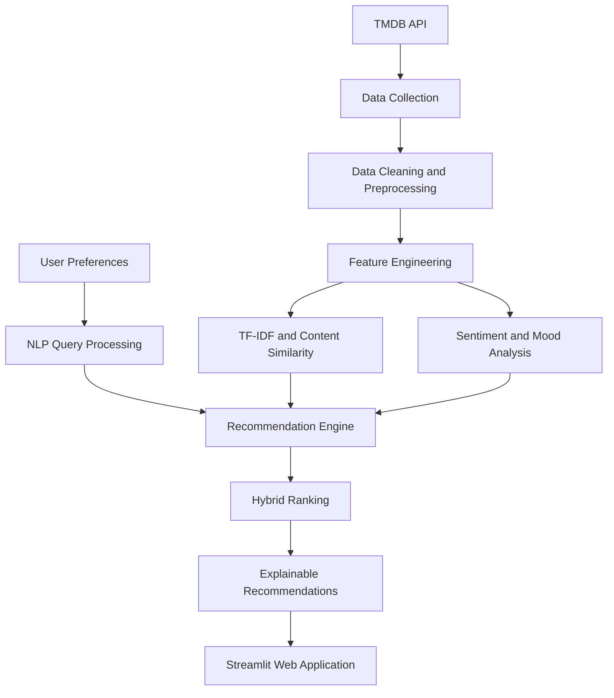

# 🎬 CineMood

### Your next movie starts with a feeling.

CineMood is an intelligent movie recommendation system that combines Natural Language Processing (NLP), mood-based analysis, content similarity, hybrid recommendation techniques, and Explainable AI (XAI).

Unlike traditional recommendation systems that primarily rely on popularity or ratings, CineMood allows users to discover movies based on their emotional preferences, natural language requests, and personalized selection criteria.

## 🌐 Live Application

**[Launch CineMood](https://cinemood-ai-mru.streamlit.app)**

The application is publicly deployed using Streamlit Community Cloud.

## 📊 Project Overview

| Indicator | Result |
|---|---:|
| Movies in the dataset | 873 |
| Recommendation models evaluated | 4 |
| Functional tests passed | 26/26 |
| Functional test pass rate | 100% |
| Reference movies used in benchmarking | 6 |
| Hybrid mood compatibility | 83.41% |

## ✨ Key Features

### Discover
Search for movies using natural language and advanced filters.

Example:

> I want a funny romantic movie under 120 minutes, rated above 7, without horror.

The system extracts relevant preferences, including genres, excluded genres, runtime, rating requirements, and emotional intent.

### Mood Match
Discover movies according to the emotional experience you are looking for.

### Similar Movies
Receive recommendations based on the content similarity of a selected reference movie.

### My Watchlist
Save interesting movies during the current browser session.

### Compare
Compare movies using relevant characteristics and recommendation indicators.

### Analytics
Explore dataset characteristics, data quality, and recommendation model performance.

### Explainable AI
Understand why a movie is recommended through interpretable recommendation scores and explanations.

## 🧠 Methodology

CineMood follows a structured data science and artificial intelligence workflow:

1. Data collection through the TMDB API.
2. Data cleaning and preprocessing.
3. Exploratory data analysis.
4. Feature engineering.
5. Natural Language Processing.
6. Sentiment and mood analysis.
7. TF-IDF vectorization.
8. Cosine similarity calculation.
9. Hybrid recommendation scoring.
10. Explainable recommendation generation.
11. Functional testing and model evaluation.
12. Interactive web application deployment.

## ⚙️ System Architecture



## 📈 Model Evaluation

Four recommendation approaches were evaluated using six reference movies.

| Model | Genre Relevance | Mood Compatibility | Average Rating | Diversity |
|---|---:|---:|---:|---:|
| Content-Based | 0.7046 | 0.6101 | 7.6156 | 0.8957 |
| Hybrid | 0.5450 | 0.8341 | 7.6928 | 0.9241 |
| Popularity Baseline | 0.1638 | 0.2682 | 7.4311 | 0.9741 |
| Sentiment-Based | 0.1620 | 0.3163 | 7.4778 | 0.9784 |

### Key Findings

- The hybrid model achieved the highest mood compatibility.
- The content-based model achieved the highest genre relevance.
- The hybrid model achieved the highest average movie rating.
- The sentiment-based model achieved the highest diversity score.
- The hybrid approach provides a balance between emotional compatibility, content relevance, movie quality, and diversity.

These results represent an exploratory benchmark rather than a comprehensive evaluation of real-world user satisfaction.

## 🛠️ Technologies Used

- Python
- Pandas
- NumPy
- Scikit-learn
- Natural Language Processing
- TF-IDF
- Cosine Similarity
- Plotly
- Streamlit
- Joblib
- TMDB API
- Google Colab
- GitHub

## 📁 Repository Structure

```text
CineMood/
│
├── .streamlit/
│   └── config.toml
│
├── assets/
│   ├── cinemood_movies.json
│   ├── data_quality.csv
│   ├── metadata.json
│   ├── model_evaluation.csv
│   ├── quality_report.csv
│   ├── similarity_matrix.npy
│   ├── tfidf_matrix.joblib
│   └── tfidf_vectorizer.joblib
│
├── CineMood_Development_Public (1).ipynb
├── app.py
├── engine.py
├── requirements.txt
├── .gitignore
└── README.md
```

The development notebook documents the data science workflow, while the Python application files provide the interactive user experience.

## 🚀 Local Installation

### 1. Clone the repository

```bash
git clone https://github.com/alecris-mc/CineMood.git
cd CineMood
```

### 2. Install dependencies

Python 3.11 is recommended.

```bash
pip install -r requirements.txt
```

### 3. Run the application

```bash
streamlit run app.py
```

The application uses a cached TMDB dataset and precomputed recommendation assets.

## 🧪 Testing and Validation

The development notebook successfully completed 26 out of 26 functional tests.

Validation included data integrity, rating ranges, sentiment scores, mood scores, filtering functionality, and recommendation-related behavior.

The 100% functional test pass rate refers to the implemented test suite and does not represent prediction accuracy.

## ⚠️ Limitations

- The dataset contains a limited snapshot of 873 movies.
- Movie information is not continuously updated.
- Mood scores are estimated from movie metadata and may not reflect individual emotional reactions.
- The recommendation system does not currently learn from long-term user behavior.
- Watchlist information is stored only during the current session.
- Model evaluation is based on a limited set of reference movies.
- Benchmark results are generated in the development notebook rather than through live application evaluation.

## 🔮 Future Improvements

- Expand the movie database.
- Introduce persistent user profiles and watchlists.
- Incorporate collaborative filtering.
- Improve semantic understanding using advanced language models.
- Conduct user satisfaction studies.
- Expand recommendation evaluation and benchmarking.
- Support multilingual natural language queries.

## 🎓 Academic Context

Developed as an academic artificial intelligence and business analytics project at Mount Royal University.

The project demonstrates the practical integration of data science, natural language processing, recommendation systems, explainable artificial intelligence, and web application deployment.

## 🎥 Data Attribution

Movie metadata is provided by The Movie Database (TMDB).

This product uses the TMDB API but is not endorsed or certified by TMDB.

---

**CineMood | Discover movies beyond ratings.**
