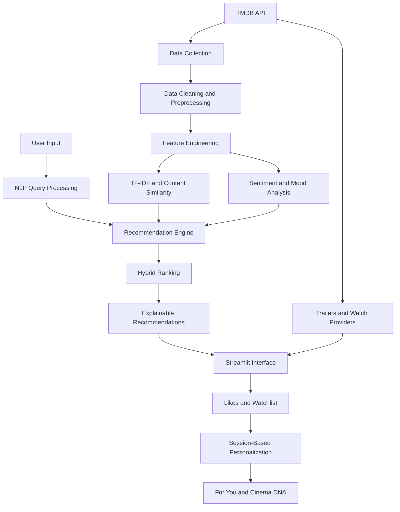

# 🎬 CineMood

### Your next movie starts with a feeling.

CineMood is an intelligent movie discovery and recommendation platform that combines Natural Language Processing (NLP), emotional preferences, content similarity, hybrid recommendation techniques, personalized discovery, and Explainable AI (XAI).

Unlike traditional recommendation systems that primarily rely on popularity or ratings, CineMood helps users discover what to watch, understand why a movie matches their preferences, and find where it is available.

## 🌐 Live Application and Website

- **[Launch CineMood](https://cinemood-ai-mru.streamlit.app/)**
- **[Official Project Website](https://sites.google.com/ucsp.edu.pe/cinemood/inicio)**
- **[GitHub Repository](https://github.com/alecris-mc/CineMood)**

The application is publicly deployed using Streamlit Community Cloud and integrated into a dedicated Google Sites website.

## 📊 Project Overview

| Indicator | Result |
|---|---:|
| Movies in the dataset | 873 |
| Recommendation models evaluated | 4 |
| Original functional tests passed | 26/26 |
| Original functional test pass rate | 100% |
| Reference movies used in benchmarking | 6 |
| Hybrid mood compatibility | 83.41% |

## ✨ Key Features

### 🔍 Discover

Search for movies using natural language and advanced filtering options.

Example:

> I want a funny romantic movie under 120 minutes, rated above 7, without horror.

The system extracts relevant preferences, including genres, excluded genres, runtime, rating requirements, and emotional intent.

### 🎭 Mood Match

Discover movies according to the emotional experience you are looking for through an interactive mood selection interface.

### 🎬 Similar Movies

Receive content-based recommendations using a selected reference movie, with similarity scores and interpretable explanations.

### 💜 Surprise Me

Explore movies through a Tinder-inspired discovery experience. Users can like or pass on suggested movies, making discovery more interactive and engaging.

### 💎 Hidden Gems

Discover potentially overlooked movies beyond conventional popularity-based recommendations.

### ⭐ Top Rated

Explore highly rated movies within the available dataset.

### ✨ For You

Receive personalized recommendations based on movies liked or saved during the current session.

The personalization mechanism combines content similarity, emotional compatibility, genre preferences, and movie quality.

### 🧬 Cinema DNA

Explore a personalized cinematic profile derived from movie preferences and interactions.

Cinema DNA becomes available after the user likes or saves at least three distinct movies.

### 🔖 My Watchlist

Save interesting movies and organize potential viewing choices during the current application session.

### ⚖️ Compare

Compare movies using relevant characteristics, emotional profiles, and recommendation indicators to support more informed viewing decisions.

### 📊 Analytics

Explore dataset characteristics, data quality, and recommendation model performance through interactive visualizations.

### ▶️ Watch Trailer

Access movie trailers through TMDB video information and YouTube integration, with a search fallback when a suitable trailer is unavailable.

### 📺 Where to Watch

Explore regional streaming availability through TMDB watch-provider information powered by JustWatch.

Users can select their country and discover available streaming, rental, and purchase options when provider information exists.

### 🧠 Explainable AI

Understand why a movie is recommended through interpretable recommendation scores, emotional characteristics, similarity indicators, and explanations.

### 🎨 Interactive User Experience

CineMood incorporates a cinematic visual identity, interactive movie cards, detailed movie information, intuitive navigation, and a responsive dark-themed interface.

## 🧠 Methodology

CineMood follows a structured data science and artificial intelligence workflow:

1. Data collection through the TMDB API.
2. Data cleaning and preprocessing.
3. Exploratory data analysis.
4. Feature engineering.
5. Natural Language Processing.
6. Sentiment and mood analysis.
7. TF-IDF vectorization.
8. Cosine similarity calculation.
9. Hybrid recommendation scoring.
10. Explainable recommendation generation.
11. Functional testing and model evaluation.
12. Interactive web application development.
13. Session-based preference personalization.
14. External movie information integration.
15. Public application deployment.

## ⚙️ System Architecture



## 🔬 Recommendation Logic

CineMood incorporates four recommendation approaches:

- **Content-Based:** Uses TF-IDF and cosine similarity to identify movies with similar content.
- **Sentiment-Based:** Uses emotional and sentiment characteristics to generate recommendations.
- **Popularity Baseline:** Provides a conventional popularity-based comparison model.
- **Hybrid:** Combines multiple recommendation indicators to balance emotional compatibility, content relevance, and movie quality.

### Session-Based Personalization

The personalized recommendation mechanism incorporates the following weights:

| Component | Weight |
|---|---:|
| Content similarity | 50% |
| Mood compatibility | 25% |
| Genre preferences | 15% |
| Movie quality | 10% |

Personalization uses movies liked or saved during the current session.

Movies marked as passed are excluded from further personalized suggestions rather than used as negative training examples.

The system does not retrain its underlying machine learning models in real time.

## 🎯 Filtering System

CineMood supports structured filters and natural language preferences to improve recommendation relevance.

Filtering criteria include:

- Movie genres
- Excluded genres
- Release year
- Runtime
- Minimum movie rating
- Emotional preferences
- Movie popularity
- Content similarity

The availability of individual filters depends on the selected application section.

## 📈 Model Evaluation

Four recommendation approaches were evaluated using six reference movies.

| Model | Genre Relevance | Mood Compatibility | Average Rating | Diversity |
|---|---:|---:|---:|---:|
| Content-Based | 0.7046 | 0.6101 | 7.6156 | 0.8957 |
| Hybrid | 0.5450 | 0.8341 | 7.6928 | 0.9241 |
| Popularity Baseline | 0.1638 | 0.2682 | 7.4311 | 0.9741 |
| Sentiment-Based | 0.1620 | 0.3163 | 7.4778 | 0.9784 |

### Key Findings

- The hybrid model achieved the highest mood compatibility.
- The content-based model achieved the highest genre relevance.
- The hybrid model achieved the highest average movie rating.
- The sentiment-based model achieved the highest diversity score.
- The hybrid approach provides a balance between emotional compatibility, content relevance, movie quality, and diversity.

These results represent an exploratory benchmark using proxy evaluation metrics rather than a comprehensive evaluation of real-world user satisfaction.

## 💼 Business Rationale

### Problem

Users often experience information overload, spend excessive time choosing movies, receive generic recommendations, and need to consult multiple platforms to identify streaming availability.

### Target Users

- Movie enthusiasts
- Streaming subscribers
- University students
- Young adults
- Users seeking personalized entertainment experiences

### Unique Value Proposition

Discover what to watch, why it matches your emotions, and where to find it, all in one intelligent platform.

### Differentiation

CineMood combines emotional recommendations, natural language search, interactive movie matching, interpretable recommendation indicators, personalized cinematic profiles, and regional streaming information within a unified discovery experience.

### Potential Business Model

CineMood could adopt a freemium business model supported by:

- Premium personalization features
- Persistent user profiles
- Potential streaming affiliate partnerships
- B2B recommendation solutions

These revenue streams represent proposed future opportunities rather than currently implemented commercial operations.

### Proposed Business Metrics

- Monthly active users
- Recommendation acceptance rate
- User retention
- Watchlist conversion
- Average movie selection time

## 🛠️ Technologies Used

- Python
- Pandas
- NumPy
- Scikit-learn
- Natural Language Processing
- TF-IDF
- Cosine Similarity
- Plotly
- Streamlit
- Joblib
- TMDB API
- JustWatch provider information
- YouTube trailer integration
- Google Colab
- Google Sites
- GitHub

## 📁 Repository Structure

```text
CineMood/
│
├── .streamlit/
│   └── config.toml
│
├── assets/
│   ├── cinemood_movies.json
│   ├── data_quality.csv
│   ├── metadata.json
│   ├── model_evaluation.csv
│   ├── quality_report.csv
│   ├── similarity_matrix.npy
│   ├── tfidf_matrix.joblib
│   └── tfidf_vectorizer.joblib
│
├── CineMood_Development_Public (1).ipynb
├── app.py
├── engine.py
├── requirements.txt
├── .gitignore
└── README.md
```

The development notebook documents the original data science workflow and model evaluation.

The recommendation engine and application files support the interactive user experience, while the assets directory contains precomputed data and recommendation resources.

## 🚀 Local Installation

### 1. Clone the repository

```bash
git clone https://github.com/alecris-mc/CineMood.git
cd CineMood
```

### 2. Install dependencies

Python 3.11 is recommended.

```bash
pip install -r requirements.txt
```

### 3. Configure TMDB API credentials

Obtain an API key from The Movie Database:

https://www.themoviedb.org/settings/api

Create a local file named:

```text
.streamlit/secrets.toml
```

Add the following configuration:

```toml
TMDB_API_KEY = "your_api_key_here"
```

For Streamlit Community Cloud deployment, configure the same credential through the application Secrets settings.

Never publish API credentials or commit the secrets file to GitHub.

The API credential supports external features such as trailers and regional watch-provider information.

### 4. Run the application

```bash
streamlit run app.py
```

The application uses a cached TMDB dataset and precomputed recommendation assets.

## 🧪 Testing and Validation

The original development notebook successfully completed 26 out of 26 functional tests.

Validation included:

- Data integrity
- Rating ranges
- Sentiment scores
- Mood scores
- Filtering functionality
- Recommendation-related behavior

The 100% functional test pass rate refers to the original implemented test suite and does not represent prediction accuracy or comprehensive testing of subsequently added features.

## ⚠️ Limitations

- The dataset contains a limited snapshot of 873 movies.
- The core movie dataset is not continuously updated.
- Mood scores are estimated from movie metadata and may not reflect individual emotional reactions.
- Personalization is limited to the current application session.
- User accounts and persistent profiles are not currently implemented.
- The system does not learn from long-term user behavior.
- Model evaluation is based on six reference movies.
- Benchmark results are generated in the development notebook rather than through live user evaluation.
- Trailer and streaming information depend on external API availability.
- Streaming availability varies across countries and may change over time.
- The proposed business model has not yet been commercially validated.

## 🔮 Future Improvements

### Technical Development

- Expand and regularly update the movie database.
- Introduce persistent user profiles and watchlists.
- Incorporate collaborative filtering.
- Improve semantic understanding through advanced language models.
- Support multilingual natural language queries.
- Develop group-based movie recommendations.
- Expand automated testing for newly implemented features.

### Business Development

- Conduct user satisfaction studies.
- Validate customer segments and market demand.
- Evaluate recommendation acceptance and retention.
- Test potential premium features.
- Explore strategic partnerships.
- Assess the feasibility of commercial deployment.

## 🎓 Academic Context

Developed for ENTR 3901: Harnessing Artificial Intelligence for Business at Mount Royal University, Fall 2026.

CineMood demonstrates the practical integration of data science, natural language processing, recommendation systems, explainable artificial intelligence, product design, business innovation, and web application deployment.

## 🎥 Data Attribution

Movie metadata, images, and video information are provided by The Movie Database (TMDB).

Watch-provider information is sourced through TMDB and powered by JustWatch.

Movie trailers are accessed through external video platforms such as YouTube.

This product uses the TMDB API but is not endorsed or certified by TMDB.

CineMood is an academic project developed for educational purposes.

---

**CineMood | Your next movie starts with a feeling.**
